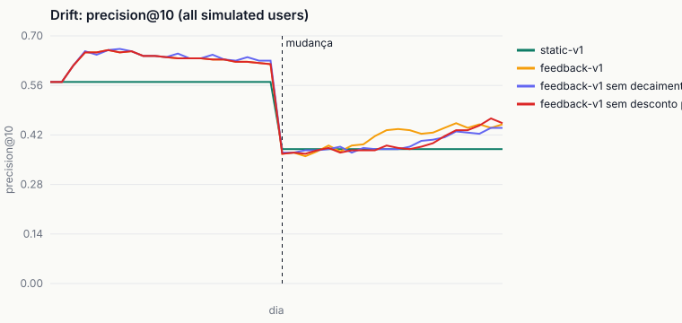
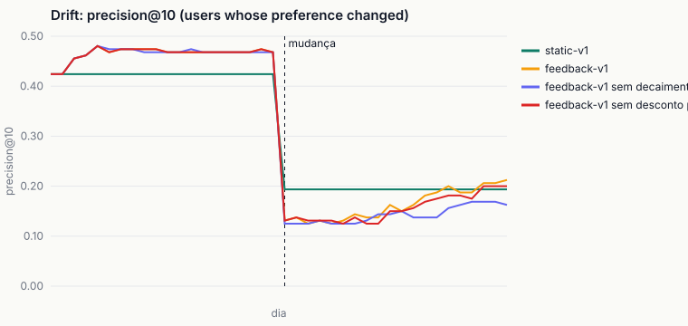

# Evaluation

> Generated by `encaixe eval report` from `var/eval/*.json`. Numbers are reported as they came out, including when learning from swipes does **not** beat the static ranking.

- Generated: 2026-10-20 23:16 UTC · rules `1b925f73e0bb` · embeddings `onnx`
- Data: 727 open jobs, 100 synthetic and 0 real candidates, 25996 events.
- Served ranker: `feedback-v1`; default aggregator: `rank_sum`.

## 1. Replay of the recorded history

400 candidate sessions, 12776 judgments. For each session the ranking is rebuilt with what was known before it; the table shows where the liked jobs landed.

| Variant | liked items | MRR | Recall@5 | Recall@10 | Recall@20 | NDCG@10 | AUC (likes vs dislikes) |
|---|---|---|---|---|---|---|---|
| static-v1 (rank_sum) | 1489 | 0.041 | 0.034 | 0.060 | 0.109 | 0.032 | 0.469 |
| static-v1 (rrf) | 1489 | 0.043 | 0.040 | 0.067 | 0.120 | 0.036 | 0.530 |
| static-v1 (weighted) | 1489 | 0.057 | 0.062 | 0.112 | 0.223 | 0.055 | 0.629 |
| feedback-v1 | 1489 | 0.057 | 0.044 | 0.095 | 0.238 | 0.045 | 0.560 |
| feedback-v1 sem decaimento | 1489 | 0.053 | 0.042 | 0.092 | 0.219 | 0.043 | 0.554 |
| feedback-v1 sem desconto por revisão | 1489 | 0.056 | 0.044 | 0.095 | 0.239 | 0.045 | 0.556 |

**Reading:** `feedback-v1` beats `static-v1` on this history (MRR 0.057 vs 0.041, AUC 0.560 vs 0.469).
Among the aggregators, the best MRR is `static-v1 (weighted)`. The default (`rank_sum`) only changes if the numbers say so on real histories; with a synthetic history this is a sanity check, not a decision.

Limitations: the job set is today's open jobs (approximation) and the history is mostly synthetic. The history was produced by simulated people swiping on decks served by `feedback-v1`, so the replay inherits that logging policy.

### 1b. Unbiased check against the oracle (no logging policy)

100 fresh simulated users, each ranked by `static-v1` over all eligible jobs (727 open), every job labelled by the oracle without noise. AUC 0.5 is a random order.

| Aggregator | AUC (liked above disliked) | precision@10 | liked share among eligible jobs |
|---|---|---|---|
| rank_sum | 0.793 | 0.547 | 0.309 |
| rrf | 0.791 | 0.610 | 0.309 |
| weighted | 0.794 | 0.821 | 0.309 |

**Reading:** the replay's static AUC (0.469) is below 0.5 while the unbiased one is 0.793. The replay compares only jobs that `feedback-v1` chose to show: inside that narrow top band, a job that made it with a lower static score got there through its history score (it resembles past likes), so static rank and likes are inversely related there. It is a selection effect of the logging policy, not a ranking that prefers what people dislike.

## 2. Drift: the preference changes on a known day

30 simulated users over 40 days on 727 open jobs. On day 20, 15 users change their preferred area; 7 of them also save a relevant revision (a new dated experience in the new area), the others change taste only. Quality is measured on the full top 10 against the current oracle (the simulation's hidden utility).

Precision@10 of the users whose preference changed:

| Variant | 7 days before | 3 days right after | last 5 days | days to recover 90% |
|---|---|---|---|---|
| static-v1 | 0.544 | 0.188 | 0.188 | not within 20 days |
| feedback-v1 | 0.612 | 0.125 | 0.274 | not within 20 days |
| feedback-v1 sem decaimento | 0.610 | 0.129 | 0.250 | not within 20 days |
| feedback-v1 sem desconto por revisão | 0.612 | 0.129 | 0.274 | not within 20 days |

**Reading:** before the change, learning from swipes helps (0.612 vs 0.544). Right after it, `feedback-v1` falls further than the static ranking (0.125 vs 0.188): old likes point the wrong way. At the end of the window it is above static (0.274 vs 0.188).
Without time decay the end-of-window precision is 0.250 (worse than with the 21-day half-life).

Caveat: the oracle is a weighted sum of area affinity, requirements, seniority, salary and arrangement, so any experiment built on it favours rankings that look like it (see the weighted baseline in the replay).

## 3. Congestion (measured, not optimized)

Top 5 candidates of each of the 8 open platform jobs (39 slots, pool of 96 eligible candidates).

| distinct candidates in the top lists | expected if random | max lists per candidate | share of slots of the top 1% | Gini of exposure |
|---|---|---|---|---|
| 24 | 33.4 | 4 | 0.103 | 0.815 |

A Gini close to 1 means the same few people fill every recruiter's top; the MVP reports it so the trade-off is visible (exploration slots are the only mitigation today).

## 4. Latency

| ranking | n | p50 | p95 | target p95 |
|---|---|---|---|---|
| jobs for one candidate | 2000 | 194 ms | 210 ms | 500 ms |
| candidates for one job | 300 | 21 ms | 88 ms | 500 ms |

## 5. Memory (encaixe bench)

| step | peak RSS | budget |
|---|---|---|
| server start + warm-up (model + one deck) | 471 MB | 700 MB |
| embed 1,000 jobs | 541 MB | 1000 MB |
| 2D projection (t-SNE) | 160 MB | 1000 MB |
| eval drift | 526 MB | 1000 MB |
| ingest --all (respostas gravadas, LLM desligado) | 92 MB | 1000 MB |

